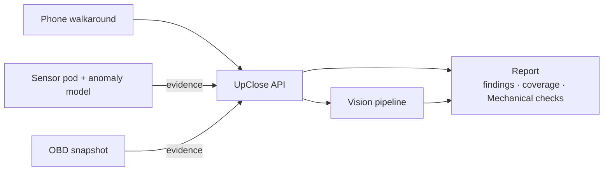

# UpClose

UpClose produces a private, evidence-linked condition report for a used car. You film a walkaround with your phone and attach the capture kits you have. The report shows what was found, where, and what wasn't checked.

This repository contains two parts.

| Folder | What it is |
|---|---|
| [`upclose/`](upclose/README.md) | **The platform.** Phone capture app (React), API (FastAPI + PostgreSQL), the vision pipeline (vehicle masking, then damage segmentation, verification and dedup), coverage-aware scoring, and the private HTML/JSON report. |
| [`upclose-rig/`](upclose-rig/README.md) | **Capture kits.** A Grove sensor pod for engine vibration, sound and temperature; an engine-anomaly model that alerts on the pod itself; and an OBD reader. |

## How it fits together

- **Attach before the report.** Capture kits attach evidence to an inspection before it is finalized. The report freezes everything it used, so the same inputs always give the same report.
- **"Not checked" is never "fine".** A missing, blurry or failed check is reported as not checked. Every finding links back to the evidence it came from.
- **Free view vs full report.** The free view shows only the headline. Details, evidence images and sensor data stay in the full report.
- **Simulated data is labeled.** Simulated, emulated or sample inputs are labeled `synthetic` everywhere they appear. See the rig README for which inputs are simulated.

## Getting started

- Platform: [upclose/README.md](upclose/README.md). Docker Compose brings up the whole stack, and it runs offline in fixture mode by default.
- Capture kits: [upclose-rig/README.md](upclose-rig/README.md). Everything runs without hardware through the simulator.
- Evidence-source wire format: [docs/evidence-sources.md](docs/evidence-sources.md).
