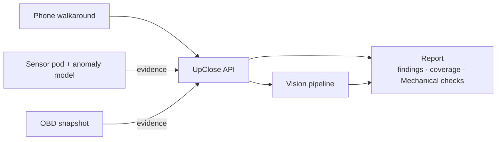

# UpClose

UpClose gives dealers and car flippers an evidence-linked condition report for a used car. You film a walkaround with your phone while a small sensor pod listens to the engine. The report shows what was found, where it was found, and what wasn't checked, and it is sealed so it can't be quietly changed later.

This repository contains two parts.

| Folder | What it is |
|---|---|
| [`upclose/`](upclose/README.md) | **The platform.** Phone capture app (React), API (FastAPI + PostgreSQL), the vision pipeline (vehicle masking, then damage segmentation, verification and dedup), coverage-aware scoring, and the private HTML/JSON report. |
| [`upclose-rig/`](upclose-rig/README.md) | **Capture kits.** A Grove sensor pod for engine vibration, sound and temperature; an engine-anomaly model that alerts on the pod itself; and an OBD reader. |

## How it fits together

- **Attach before the report.** Capture kits attach evidence to an inspection before it is finalized. The report freezes everything it used, so the same inputs always give the same report.
- **"Not checked" is never "fine".** A missing, blurry or failed check is reported as not checked. Every finding links back to the evidence it came from.
- **Free view vs full report.** The free view shows only the headline. Details, evidence images and sensor data stay in the full report.
- **Simulated data is labeled.** Simulated, emulated or sample inputs are labeled `synthetic` everywhere they appear. See the rig README for which inputs are simulated.

## Sense, understand, act

| Step | What happens |
|---|---|
| **Sense** | Phone video of the car, zone by zone. A Grove sensor pod on the engine records vibration (about 400 samples a second), sound and temperature. An OBD snapshot reads trouble codes. Optional engine audio and the VIN. |
| **Understand** | Meta SAM 3.1 finds the car, then damage on the car only. Spark (Meta's LLM) double-checks every damage finding, reads the dashboard warning lights and writes the advisory. The engine-anomaly model learns this engine's healthy baseline and scores each half-second window against it. Rules decode trouble codes and the VIN (check digit, then NHTSA vPIC). |
| **Act** | The pod's screen switches to `MISFIRE SUSPECTED`, the LED blinks and the buzzer chirps while you are still at the car. The report gives Visual, Mechanical and Overall scores, every finding with the frame it came from, the vibration chart, questions for the seller and checks for a mechanic, and a spoken briefing. |

## Which parts are models and which are rules

| Kind | Where |
|---|---|
| Vision model | Meta SAM 3.1: vehicle mask, damage segmentation, locating the instrument cluster |
| LLM | Spark: verifying damage findings, reading dashboard lights, the advisory and the narration script |
| Our own model | The engine-anomaly model (baseline-relative, no labeled fault data) |
| Fixed rules | Accepting or rejecting every LLM answer, trouble-code and VIN decoding, and scoring with versioned weights in `upclose/services/api/config/` |
| Voice | ElevenLabs: the spoken capture guide and the report narration |
| Storage | PostgreSQL for inspections and jobs, S3-compatible storage for media, Tiger Data (a TimescaleDB hypertable) for the pod's time series |

Scores are always numeric. An unseen body zone or a missing OBD snapshot, engine pod or dashboard reading lowers the score, and the report lists each one as its own line with the reason. A missing check is never treated as a pass.

Clips are processed while the rest of the car is being filmed. In our recorded demo run, the report was ready about a minute after tapping Finish.

## Simulated data

The demo uses a rendered 3D car (a three.js digital twin with damage at known positions), an emulated OBD adapter and simulated engine audio. All of these are labeled `synthetic` in the product. The engine-anomaly model was evaluated on simulator data only; see [upclose-rig/eval/anomaly_report.md](upclose-rig/eval/anomaly_report.md). No real-car accuracy is claimed.

## Getting started

- Platform: [upclose/README.md](upclose/README.md). Docker Compose brings up the whole stack, and it runs offline in fixture mode by default.
- Capture kits: [upclose-rig/README.md](upclose-rig/README.md). Everything runs without hardware through the simulator.
- Evidence-source wire format: [docs/evidence-sources.md](docs/evidence-sources.md).
