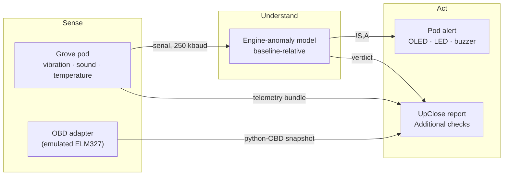

# UpClose Rig

Hardware and AI capture kits for [UpClose](../upclose/README.md), a used-car inspection app.

The rig adds what a phone camera can't capture:
- a **Grove sensor pod** that senses engine vibration, sound and temperature;
- an **engine-anomaly model** that learns what a healthy engine looks like and alerts the inspector **on the pod itself**;
- an **OBD reader** for trouble codes and the "seller just cleared the codes" trick.

Everything the rig captures is attached to an UpClose inspection before the report is generated, and shows up there as **Additional checks**.



## About the data

We built this without a car or a physical OBD adapter, so some inputs are simulated, and everything says so.
- **Simulator recordings and bench data** from the pod are labeled `synthetic`. The tool refuses any other label for them.
- **OBD data** comes from an emulated ELM327 adapter with a synthetic VIN.
- **The anomaly model's evaluation** uses simulator data only and is **not real-car accuracy**. See [eval/anomaly_report.md](eval/anomaly_report.md).
- `cached` means a replay of a real engine recording. `live` means streamed from a real vehicle right now.

## Hardware

One **Seeed Grove Beginner Kit for Arduino** (ATmega328P, micro-USB, programmed as an Arduino Uno). Every module is pre-wired on the board:

| Module | Pin / bus | Used for |
|---|---|---|
| LIS3DHTR accelerometer | I2C 0x19 | engine vibration, about 400 Hz |
| Sound sensor | A2 | loudness, about 100 Hz |
| DHT20 temperature/humidity | I2C 0x38 | cold-start check, every 2 s |
| Button | D6 | short press injects an OBD fault; hold for 1 s to mute |
| Rotary knob | A0 | simulated RPM for the OBD emulator (600–3000) |
| OLED 0.96" (SSD1315) | I2C 0x3C | live status and alerts |
| LED / buzzer | D4 / D5 | alert |

Measured on the board: accelerometer at 397 samples/s, about 8 mg resolution, 0 garbled lines over USB. Windows needs the Silicon Labs **CP210x** USB driver for the kit's CP2102N chip.

## Quick start (no hardware needed)

```bash
python -m venv .venv            # Python 3.12
# Windows: .venv\Scripts\activate    macOS/Linux: source .venv/bin/activate
pip install -e ".[dev]"
pytest                          # no hardware or network needed

# Simulated pod in real time: learns a healthy baseline, then a misfire at 35 s
python -m upclose_rig live --port sim --seconds 60 --record recordings/sim.upr
```

The simulator emits exactly what the firmware does, and recordings from both share one file format. A real recording drops in with no code changes.

## With the Grove pod

1. **Flash the firmware.** In the Arduino IDE choose board **Arduino Uno** and the kit's COM port. Install the **U8g2** library. Open `firmware/grove_pod/grove_pod.ino` and upload.
2. **Close the Serial Monitor.** Only one program can use the port.
3. **Run the live loop:**
   ```bash
   python -m upclose_rig monitor --port COM3          # live values and rates
   python -m upclose_rig live --port COM3 --baseline-s 20 --record recordings/run.upr
   ```
   The pod shows `LEARNING 20s`, then `NORMAL`. Tap or shake near it and it switches to `MISFIRE SUSPECTED`, blinks and chirps. It returns to `NORMAL` once things settle. Hold the button for 1 s to mute the buzzer.

   In a desk test, tapping next to the pod raised an alert within seconds, and the alert cleared after the tapping stopped. A 48 s run with the pod still raised no alerts.

## Sending evidence to UpClose

Evidence attaches to an inspection that is still capturing. The owner token is read from the environment only, never from command arguments, and is never printed.

```bash
export UPCLOSE_OWNER_TOKEN="<owner token>"     # PowerShell: $env:UPCLOSE_OWNER_TOKEN = "..."
python -m upclose_rig post --recording recordings/run.upr --verdict recordings/run.verdict.json \
    --provenance synthetic --session <session-id> --api http://localhost:8000

python -m upclose_rig obd-snapshot --dtc P0301 --out recordings/obd.json
python -m upclose_rig post --body recordings/obd.json --session <session-id> --api http://localhost:8000
```

`post` reports one of these results:
- `201`: created, with the source id, hash and summary.
- `409`: the inspection is already finalized.
- `401`: the token was rejected.
- `404`: the inspection was not found.

Re-posting the same kind while capturing replaces it. The wire format is described in [docs/evidence-sources.md](../docs/evidence-sources.md).

## Engine-anomaly model

We have no labeled car-fault data, so the model works the way real machine monitors do. It learns **this engine's** healthy baseline, then scores how far each new 0.5 s window deviates from it.

- **Features:** RMS, crest factor, kurtosis, band energy at the firing frequency and its sub-orders, and firing-to-firing amplitude spread. Optional audio features are added from a WAV clip.
- **Model:** robust standardization, Ledoit-Wolf-shrunk covariance and Mahalanobis distance. Half of the baseline blocks fit the model; the other half set the threshold at the 99th percentile. Models are stored as JSON, not pickle. It uses numpy only.
- **Verdict:** `anomaly_suspected`, `no_anomaly_detected` or `not_assessed`.
  - Short, flat, clipped or non-finite input is never scored as clean.
  - Scores are distances, not probabilities.
  - The model says "unlike this engine's baseline", not "faulty".
- **Evaluation:** 336 held-out simulator recordings across RPM, noise and misfire severity. Window ROC-AUC is 0.997, and 4 % of healthy recordings raised a false alarm. Synthetic only: see [eval/anomaly_report.md](eval/anomaly_report.md). Regenerate it with `python -m upclose_rig anomaly-eval`.

```bash
python -m upclose_rig simulate --seconds 60 --rpm 780 --out recordings/healthy.upr
python -m upclose_rig simulate --seconds 30 --rpm 780 --misfire-every 4 --out recordings/misfire.upr
python -m upclose_rig anomaly-fit   --recording recordings/healthy.upr --out recordings/model.json
python -m upclose_rig anomaly-score --model recordings/model.json --recording recordings/misfire.upr
```

## Emulated OBD

There is no car computer here. Instead, the [ELM327-emulator](https://pypi.org/project/ELM327-emulator/) package runs in-process, and the real **python-OBD** library talks to it over a loopback socket, exactly as it would talk to a Wi-Fi OBD dongle.
- Its state is controllable: stored or pending trouble codes, the check-engine light, readiness monitors, RPM and coolant temperature.
- A "clear codes" request (what a seller does before a sale) resets the codes and zeroes the distance and warm-up counters. It also leaves the emissions monitors incomplete. UpClose flags exactly that pattern as **codes recently cleared**.

```bash
python -m upclose_rig obd-snapshot --cleared --out recordings/obd_cleared.json   # the seller-cleared variant
python -m upclose_rig obd-serve --port 35000 --dtc P0301                         # for any python-OBD client
```

With a real adapter, the same query path works: `obd-snapshot --obd-port COM7 --provenance live`.

## Tiger Data (time-series store)

Pod samples and anomaly verdicts can also be stored as time series in a
Tiger Cloud (Timescale) database, separate from the UpClose inspection
database, so a run can be queried per second (vibration RMS, sound level,
anomaly score).

```bash
export TIGER_DATABASE_URL="<connection string>"   # PowerShell: $env:TIGER_DATABASE_URL = "..."
python -m upclose_rig tiger-init
python -m upclose_rig simulate --seconds 30 --out recordings/sim.upr
python -m upclose_rig tiger-push recordings/sim.upr --provenance synthetic
python -m upclose_rig tiger-summary sim
```

`tiger-push` takes `--verdict` (an anomaly verdict JSON) and `--run-id`
(default: the recording file name). Simulator recordings must use provenance
`synthetic`, the default; only board recordings from a real engine may use
`real`. The connection string is read from the environment only and never
appears in arguments, logs, or error messages. The schema lives in
`sql/tiger_schema.sql`: `pod_runs`, the `pod_samples` hypertable,
`pod_verdicts`, and a per-second `pod_samples_1s` rollup.

## Reference

### Commands

| Command | What it does |
|---|---|
| `simulate` | Synthetic engine recording (RPM, misfire, cold start, scripted button and knob events) |
| `record`, `monitor` | Record or watch the pod's serial stream |
| `live` | Learn a baseline, score live, drive the pod's alerts, write a verdict (`--port COMx` or `sim`) |
| `bundle`, `post` | Build or send a `rig_telemetry` body (`--verdict` embeds the model verdict) |
| `obd-snapshot`, `obd-serve` | Query or serve the emulated OBD adapter |
| `anomaly-fit`, `anomaly-score`, `anomaly-eval` | Fit, score, or regenerate the evaluation report |
| `tiger-init`, `tiger-push`, `tiger-summary` | Store a run in Tiger Data and query its per-second rollup |

### Pod → host line protocol (`upclose-pod v1`, 250000 baud)

```
#upclose-pod v1                    header after every reset
A,<t_ms>,<x_mg>,<y_mg>,<z_mg>      accelerometer, ~400 Hz
S,<t_ms>,<level>                   sound level 0..1023, ~100 Hz
T,<t_ms>,<celsius>,<rh>            temperature and humidity, every 2 s
B,<t_ms>,<0|1>                     button edge
K,<t_ms>,<0..1023>                 knob, on change
#...                               comments and acknowledgements
```

### Host → pod commands

| Line | Pod shows |
|---|---|
| `!S,L<seconds>` | `LEARNING <n>s` |
| `!S,N` | `NORMAL` |
| `!S,A` | `MISFIRE SUSPECTED`; the LED blinks and the buzzer chirps once a second |
| `!S,X` | `NOT ASSESSED` (flat or clipped signal) |
| `!M,<0\|1>` | buzzer mute off or on |

The pod answers each accepted command with `#ack,<command>`. It returns to idle if it hears nothing for 5 s.

The firmware never blocks the sampling loop:
- The accelerometer's 32-sample FIFO is drained every 5 ms.
- The DHT20 is read with a non-blocking state machine.
- The OLED redraws one row per pass.
- The buzzer uses Timer2 `tone()`.

### Recording file

JSON Lines. Line 1 is a header object (`format`, `source` = `board` or `simulator`, `protocol`, `started_at`); after that, each line is one record array, e.g. `["A",12,-4,9,1001]`.

### Verdict (`upclose-anomaly-verdict/1`)

| Field | Meaning |
|---|---|
| `verdict`, `reason` | the outcome, and why it is `not_assessed` (`too_short`, `flat_signal`, `clipped_signal`, …) |
| `windows`, `anomalous_windows`, `anomalous_fraction` | how much of the recording was unlike the baseline |
| `max_score`, `median_score`, `threshold`, `fraction_threshold`, `min_anomalous_windows` | distances and the alert rule |
| `top_features`, `anomalous_runs` | what changed, and when (up to 10 time ranges) |
| `model` | firing frequency, sample rate, baseline length and source, config hash |
| `note` | fixed disclaimer: relative to the baseline, not a diagnosis |

Quality rules:
- `flat_signal`: AC standard deviation under 1.5 mg on every axis.
- `clipped_signal`: repeated extremes within 10 % of the ±4000 mg full scale.
- The live scorer latches `not_assessed` until the signal has been clean for about 1 s.

## Safety (real engines)

- Attach the pod with the **engine off**, secured so it can't reach moving parts.
- Route the USB cable away from belts, fans, pulleys and hot manifolds. Keep the laptop out of the engine bay.
- The pod isn't rated for engine-bay heat. Never drive with it attached.

## Layout

```
firmware/grove_pod/    Grove pod firmware
src/upclose_rig/       bridge, simulator, recording format, OBD emulation, bundles, CLI
src/upclose_rig/anomaly/  features, model, live scorer, evaluation
eval/                  generated evaluation report (synthetic)
tests/                 pytest; tests/fixtures holds a real still-pod recording
```
