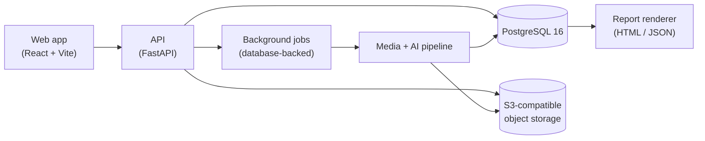

# UpClose

Video-based used-car condition screening: film a car, get a private, evidence-linked condition report.

UpClose helps buyers and sellers document a used car's visible condition before an in-person inspection. It is a screening tool — it does not replace an inspection by a qualified mechanic.

**Live site:** [tryupclose.pages.dev](https://tryupclose.pages.dev) · **Sample report:** [tryupclose.pages.dev/sample](https://tryupclose.pages.dev/sample/)

The public site is the static landing page and a sample report. The inspection app itself (uploads, AI pipeline, private reports) runs on the local stack described in [Quick start](#quick-start) and [Running the live AI pipeline locally](#running-the-live-ai-pipeline-locally).

## What it does

1. **Capture.** Record guided clips for eight areas of the car — driver side, passenger side, front and rear body, tires, dashboard, engine bay, underbody, and interior — or upload one continuous video (up to 3 minutes and 200 MiB). In a single video you can optionally mark sections so findings keep their original timestamps, and any uncovered areas can be filmed afterwards as guided follow-ups.
2. **Upload.** Clips are uploaded directly to private object storage. Processing runs in the background and progress is shown in the browser.
3. **Attach capture kits (optional).** Before you finish, other capture kits can add their own evidence to the inspection: engine vibration and temperature from the sensor pod, the engine-anomaly verdict, and an OBD snapshot. The capture screen shows which kits are attached.
4. **Assess.** The backend normalizes the media, identifies the vehicle first, and only then looks for damage on the vehicle-masked media. Candidate findings are verified and deduplicated before anything is shown.
5. **Score.** A deterministic scoring engine turns verified findings into a condition score that accounts for coverage: areas that were not filmed, were too blurry, or could not be assessed are reported as uncovered rather than treated as clean.
6. **Report.** You get a private report (HTML and JSON) where every displayed finding links back to its persisted evidence — the frame and location it came from. Capture-kit evidence appears as **Mechanical checks** and feeds a Mechanical score beside the Visual one. A free preview shows the headline result; the full evidence report is unlocked with a payment.

## Key features

- **Two ways to film:** step-by-step guided clips, or one continuous walk-around video with optional marked sections.
- **Two-stage AI pipeline:** vehicle segmentation runs first and produces a mask; damage segmentation runs second, only on masked media. This keeps scratches, dents, and rust candidates tied to the car itself rather than the background.
- **Verified, deduplicated findings:** model output is validated before it is stored or shown. Uncertain candidates are not silently turned into clean results, and model confidence is presented as uncalibrated — not as an accuracy probability.
- **Coverage-aware deterministic scoring:** the same inputs always produce the same score. Missing, failed, or unsupported coverage lowers completeness instead of inflating the result.
- **Evidence-linked reports:** every finding in the paid report points to its source evidence. Free previews cannot access paid evidence through the page, the API, image routes, or caches.
- **Private by default:** reports are owner-only and public sharing is disabled. Deleting an inspection immediately revokes access, and stored media is then purged and verified gone.
- **Capture-kit evidence:** sensor-pod telemetry, engine-anomaly verdicts and OBD snapshots are validated, summarised deterministically and frozen into the report as Mechanical checks. They drive a separate Mechanical score (unvalidated weights, shown by category with the Visual score; Overall blends the two only when both exist), and a kit that wasn't used reads "Not checked", never as a pass. The free preview shows only whether each check ran and how many flags it raised. See [the capture kits](../upclose-rig/README.md) and [the evidence-source format](../docs/evidence-sources.md).
- **Optional accounts:** dealers and frequent sellers can create an email/password account to claim inspections and revisit earlier reports. The anonymous one-off flow works without an account.
- **Test-mode payments:** report unlock uses Stripe in test mode. Payment status is confirmed from verified provider state — simply returning to the site in the browser grants nothing.

## Architecture



| Component | What it does |
|---|---|
| `apps/web` | Browser app: consent, guided and single-video capture, upload, live progress, free preview, checkout return, and the private owner report. |
| `services/api` | FastAPI backend: sessions, uploads, accounts, billing, deletion, and report endpoints, plus the background processing pipeline (media normalization, vehicle masking, damage segmentation, verification, deduplication, scoring, and report generation). |
| `infra` | Docker Compose stack and container definitions for local running. |
| `scripts` | Local launch and verification entry points. |

Processing is idempotent where it matters: jobs may run more than once, but committed results and charges are tracked so a retry does not double-publish or double-charge.

## Quick start

Requirements: Docker Desktop (or Docker Engine with Compose) running locally.

```powershell
docker compose -f infra/compose.yaml up --build -d
docker compose -f infra/compose.yaml exec api alembic upgrade head
```

Then open:

| Service | Address |
|---|---|
| Web app | http://localhost:5173 |
| API liveness | http://localhost:8000/health |
| API readiness | http://localhost:8000/ready |
| PostgreSQL | localhost:55432 (internal port 5432) |
| Object storage (local emulator) | localhost:4566 |

All ports bind to loopback only. The default stack runs in fixture mode, so no `.env` file, API keys, or payment credentials are needed. Source is copied into the images, so rebuild after editing backend or frontend code:

```powershell
docker compose -f infra/compose.yaml up --build -d
```

Stop the stack with:

```powershell
docker compose -f infra/compose.yaml stop
```

Do not remove volumes unless you intend to discard local data.

### Running the live AI pipeline locally

The default stack is fully offline. To run real inference on your own footage, only the background worker is switched to live mode; the API stays in fixture mode and never receives a model key.

1. Add to a local `.env` (never commit it): `MODEL_API_KEY=<your Meta API key>`, and, if the key is a non-Standard demo key, `MODEL_ALLOW_NON_STANDARD_DEMO=true`. Budget caps default to `MODEL_SESSION_BUDGET_CENTS=500` and `MODEL_DAILY_BUDGET_CENTS=5000`.
2. Load `.env` into your shell, then start the worker with the live overlay:

   ```powershell
   docker compose -f infra/compose.yaml -f infra/compose.live-demo.yaml up -d --no-deps --force-recreate worker
   docker compose -f infra/compose.yaml logs --tail 3 worker   # expect: Queue runner started (mode=live)
   ```

3. Optional for local demos: set `DEMO_FREE_UNLOCK=true` and an `OPERATOR_TOKEN` for the API, then recreate it (`up -d --no-deps --force-recreate api`). The first unlocks the full report without payment; the second enables the operator privacy review below.
4. Evidence images appear in a report only after an operator has reviewed and approved a privacy derivative for each finding:

   ```powershell
   ./scripts/approve-derivatives.ps1 -SessionId <session id>            # writes previews to .tools/previews
   ./scripts/approve-derivatives.ps1 -SessionId <session id> -Approve   # after checking every preview
   ```

#### Real providers for the advisory, spoken report, voice guide, Tiger Data and VIN decode

These are off by default (everything stays fixture). Provider keys live in `.env`, which compose does not read by itself, so pass it explicitly and never print it. From the `upclose/` folder:

Live advisory and fresh ElevenLabs synthesis currently fail closed because their priced budget reservation and dispatch integration is incomplete. Advisory shows an unavailable reason; report narration and capture guidance keep their written captions. Fixture narration remains enabled. Setting provider variables alone does not make these live paths ready; the following overlay command configures the services but does not bypass this gate.

```powershell
docker compose --env-file .env -f infra/compose.yaml -f infra/compose.live-demo.yaml -f infra/compose.live-full.yaml up -d --no-deps --force-recreate worker api
```

Drop `compose.live-demo.yaml` to keep the vehicle and damage steps in fixture mode while still using the other providers. The worker receives `ADVISOR_PROVIDER`, `ADVISOR_META_MODEL`, `ADVISOR_GEMINI_MODEL`, `GEMINI_API_KEY`, `VOICE_PROVIDER`, `ELEVENLABS_API_KEY`, `ELEVENLABS_VOICE_ID`, `ELEVENLABS_MODEL_ID`, `TIGER_DATABASE_URL` and `VIN_PROVIDER`; the API receives only the voice variables, for the spoken capture guide. Each defaults to its fixture value. Switching the advisory from Meta to Gemini is an environment change only (`ADVISOR_PROVIDER=gemini`).

The live inference overlay also selects the Meta dashboard reader (`DASH_READER_PROVIDER=meta`), with SAM localizing the instrument panel before Spark reads its warning lights. Dashboard readings are uncalibrated, and unreadable footage stays not checked. Dashboard crops remain private while a dashboard-specific operator approval binding is unavailable; the paid report shows the reading and flags without the crop. The default compose file uses synthetic fixture readings and makes no provider calls. Keep `VOICE_PROVIDER=fixture` until you intend to synthesize real narration and capture guidance.

Restart single services with `--no-deps`, and export the same environment each time: `docker compose up` on one service otherwise recreates its dependencies with default settings. Running `up -d worker` without the live overlay returns the worker to fixture mode, which is the spend kill-switch.

### How long a report takes

Measured on the local stack (8-core machine, live mode) with an 8-second, 720p clip of one side of a car (46 sampled frames):

| Stage | Typical time |
|---|---|
| Upload and media normalization | ~30 s |
| Vehicle segmentation and masking | 4–6 min |
| Damage segmentation (5 concepts) | ~1 min |
| Verification (about 10 s per candidate) | ~1 min |
| Claims, scoring, narration, rendering | under 1 s |
| **Total** | **about 7–8 minutes** |

Expect to wait about 7–8 minutes for a short clip. The vehicle step dominates: the provider returns lossless-compressed masks for every frame, which are currently decoded on a single CPU core. Keep live clips around 10–15 seconds for now; time grows roughly linearly with clip length, and long clips can exceed the current job deadline and masked-video size limits. Fixture mode finishes in seconds.

## How processing works

Every inspection is an owner-only session. Media never passes through the API: the browser uploads directly to private object storage with presigned multipart URLs, can resume an interrupted upload, and the server verifies the stored object before accepting it.

Work then runs as jobs in a PostgreSQL-backed queue. Each job holds a time-limited lease. A worker that loses its lease cannot publish results, and every publication runs in a single fenced transaction, so a job may run more than once without double-publishing or double-charging.

1. **Ingest.** ffmpeg probes and normalizes each clip into a 720p proxy and samples frames (6 fps for walk-around clips). A quality check records blur and exposure problems; unusable footage is marked as such rather than scored.
2. **Vehicle mask.** Meta SAM 3.1 segments the prompt "car" across the video. For each frame, the largest mask is taken as the inspected vehicle; frames where the car is not visible are blanked, and too few visible frames fails closed. SAM returns box-local masks capped at 1024 px, which are resampled onto their boxes. A masked copy of the video, with the vehicle kept and everything else neutral grey, is encoded for the next stage.
3. **Damage segmentation.** SAM runs once per damage concept (rust, paint bubbling, dent, scratch) on the masked video only, so detections stay on the car. Every candidate keeps its frame, box, and exact mask as persisted evidence.
4. **Verification.** Muse Spark judges each candidate from the full frame plus a crop of its box, against a written severity rubric for that concept. It answers in a strict JSON schema: confirmed, rejected, duplicate, or unverifiable, plus a 1–5 severity and the affected part when confirmed. The answer is validated before anything is written. A candidate that cannot be verified stays labelled "unverified" and never counts as clean.
5. **Claims, score, narration, render.** Listing claims are checked against the evidence. A deterministic scoring engine turns verified findings into per-zone scores: severity × concept weight, deducted from 100 and capped. A zone is only scored when every required concept was assessed and every candidate resolved; partial or missing coverage is reported, never treated as clean. An overall index needs at least three scored zones. Repair ranges come from a versioned cost table, and only for repairs it supports; anything else is listed as "get a quote". The report is then frozen as an immutable revision.

Guardrails that apply throughout:

- **Spend control.** Every provider call reserves budget first: frames for SAM, and a conservative token upper bound for Spark. The call is then settled against the provider's reported usage, within per-session and daily caps. Only transport failures such as timeouts and 5xx responses are retried; a billed response that fails validation is not paid for again.
- **Privacy.** No original frame is ever served publicly. Report images are operator-reviewed derivatives with the finding drawn on and any redactions applied, and approvals are immutable once granted.
- **Honest output.** Model confidence is shown as uncalibrated, free previews cannot reach paid evidence, and payment status comes only from verified provider state.

## Configuration

Configuration is via environment variables; `.env.example` lists the full surface with local development placeholders only. The settings that matter most:

| Variable | Default | Meaning |
|---|---|---|
| `MODEL_MODE` | `fixture` | `fixture` runs the whole pipeline offline with synthetic data and no model calls. Live model mode is opt-in, runs only in the background processor, and is subject to per-session and daily budget caps. |
| `PAYMENTS_MODE` | `fixture` | `fixture` uses an in-process fake payment flow. `test` uses Stripe test mode and requires test keys; live Stripe keys are refused. |
| `PUBLIC_SHARING_ENABLED` | `false` | Public report sharing stays off. |
| `SESSION_CREATION_LIMIT_PER_DAY` | `3` | Per-owner daily limit on new inspections. |
| `OPERATOR_TOKEN` | empty | Separate credential for operator endpoints; empty disables them. |

## Running tests

The full local verification suite rebuilds the images, creates its own disposable test database (removed afterwards), and runs backend tests including real PostgreSQL concurrency and migration checks, plus web type checks, tests, and production builds:

```powershell
./scripts/verify-local.ps1
```

Backend only:

```powershell
./scripts/verify-local.ps1 -BackendOnly
```

Targeted checks inside the running containers:

```powershell
docker compose -f infra/compose.yaml exec api python -m pytest
docker compose -f infra/compose.yaml exec web npm run typecheck
docker compose -f infra/compose.yaml exec web npm run test -- --run
docker compose -f infra/compose.yaml exec web npm run build
```

Plain pytest skips PostgreSQL integration tests unless a disposable test database URL is supplied; the verification script above handles that automatically. Tests run in fixture mode and make no model calls.

## Project layout

```
apps/web/       Browser app (React, TypeScript, Vite)
services/api/   Backend API, background processing, and tests (Python, FastAPI)
infra/          Docker Compose files and container definitions
scripts/        Local launch and verification scripts
```

## Status

UpClose is a working prototype, and we want to be direct about what that means:

- **Live pipeline works end to end locally.** On real footage of a heavily rusted car, the full live path ran with no retries: upload, SAM vehicle masking, SAM damage segmentation, Spark verification, scoring, and report rendering. SAM proposed six rust candidates. Spark confirmed three at severity 4 (roof edge, hood, and one more) and marked the others unverifiable from the footage, and the report shows each finding on its frame.
- **Fixture results are synthetic.** The default offline mode exercises the complete flow — capture, upload, pipeline, scoring, report, payment, and deletion — with synthetic data. It demonstrates the product, not detection quality.
- **Live AI quality is not yet validated.** Working end to end is not the same as measured accuracy: detection quality has not been evaluated against independently labeled real-world footage, so no accuracy claims are made.
- **Known limits.** Vehicle mask decoding is single-threaded, which accounts for most of the 7–8 minute wait. The repair cost table only prices the repairs it has sourced figures for. A one-side video produces a zone result but never an overall index.
- **Not a production system.** Local storage emulation does not establish production storage behavior, and real-device capture and payment fulfillment in a hosted environment remain to be proven end to end.
- **Screening, not certification.** Even with validated models, a video screening cannot see everything an in-person mechanical inspection can.
